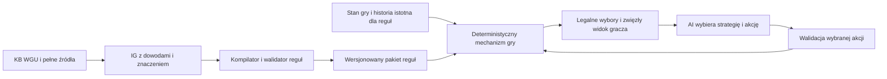

# IG dla deterministycznych legalnych akcji przeciwnika AI

- **Data:** 2026-10-11.
- **Status:** plan architektury, bez implementacji.
- **Wymaganie właściciela:** IG ma umożliwić szybkie, deterministyczne
  wyznaczanie legalnych akcji, zostawiając AI tokeny i kontekst na decyzje.
- **Pierwszy materiał:** pełna instrukcja SPQR oraz istniejąca KB WGU.

Ten cel uzupełnia [architekturę importu](IG-WGU-ARCHITECTURE.md).
Sama wyszukiwalna baza reguł nie wystarcza jako docelowy wynik WGC.
Potrzebny jest IG z warstwą znaczenia, którą można skompilować do lokalnego
mechanizmu legalności i zmian stanu. Obecne zadanie obejmuje zaplanowanie
tego mechanizmu; nie budujemy go w tej sesji.

## Podział pracy między WGC, mechanizm gry i AI

WGU utrzymuje KB. WGC uzgadnia ją ze źródłami, formalizuje potrzebne
znaczenie i buduje pakiet reguł. Mechanizm gry zna stan, oblicza legalność,
egzekwuje kolejność i zmiany. AI wybiera jedną z dopuszczalnych decyzji.
Nie czyta ponownie instrukcji, by ustalić, czy akcja jest legalna.

Wiążący stan dostarcza mechanizm gry lub zweryfikowany adapter stanu.
Nie jest nim opis sytuacji wygenerowany przez LLM. Integrację z planszą,
platformą gry lub innym programem trzeba później określić osobno.

## Trzy warstwy danych

| Warstwa | Zawartość | Rola |
|---|---|---|
| IG źródłowy | Dokumenty, regiony, klauzule, aspekty, relacje, interpretacje, luki i review | Dowód pochodzenia i kompletności |
| IG semantyczny | Typowany stan, akcje, warunki, domeny wyborów, procedury, skutki, obliczenia i widoczność | Znaczenie reguł potrzebne do gry |
| Pakiet wykonawczy | Sprawdzone wyrażenia i operacje, indeksy, stałe, tabele oraz mapa do IG | Szybka lokalna ocena bez LLM |

Nie utrzymywać trzech ręcznie niezależnych opisów tej samej reguły.
Warstwa semantyczna odwołuje się do klauzul; pakiet jest generowany
i nieedytowalny. Każda wykonywana operacja ma mapę pochodzenia do źródła
i dokładnej rewizji interpretacji. Zmiana źródła wyznacza zakres ponownego
review i kompilacji.

Pełny tekst, cytaty, obrazy i większość dowodów pozostają poza gorącą
ścieżką obsługi tury. Są dostępne do wyjaśnienia lub audytu na żądanie.

## Kontrakt znaczenia potrzebny od początku

Poniższe elementy muszą być przewidziane w minimalnym modelu, choć ich
implementację rozkładamy na etapy pełnego celu:

- **Stan:** typy jednostek, ich własności i położenie, zasoby, statusy,
  aktywny uczestnik, okna decyzji, faza i ograniczenia użycia.
- **Historia istotna dla reguł:** zdarzenia, przyczyny i fakty potrzebne
  obecnym warunkom. Pełny dziennik do audytu; w runtime także sprawdzalne
  liczniki i znaczniki pochodne, zamiast każdorazowego przeglądania logu.
- **Akcja:** identyfikator rodzaju, podmiot decyzyjny, parametry o typach,
  domeny dozwolonych wartości, koszt i warunki legalności.
- **Wybory:** moment podjęcia, uczestnik, liczność zbioru, zależności między
  parametrami oraz trwałość powiązania wybranych obiektów między krokami.
- **Procedury:** kroki, priorytety, reakcje, przerwania, stos kontynuacji,
  warunki powrotu lub zastąpienia oraz moment zakończenia akcji.
- **Zmiany:** skutki natychmiastowe i odroczone, koszt próby/sukcesu,
  warunki zatwierdzenia, anulowania i ewentualnego cofnięcia.
- **Obliczenia:** typowane liczby i jednostki, uporządkowane modyfikatory,
  wynik naturalny i zmodyfikowany, zaokrąglenia oraz odczyt tabel z legendą.
- **Przestrzeń:** zajmowane heksy, ukierunkowanie, sąsiedztwo, ZOC, LOS,
  legalne ścieżki i teren. Wspólne operacje przestrzenne z osobnymi politykami
  profilu, bez założenia jednej geometrii wszystkich gier.
- **Losowość i informacja:** węzły losowania, pule z licznościami i tożsamością
  elementów, ujawnianie danych, dostępność obserwacji dla poszczególnych stron.
- **Profil:** wydanie, opcje, scenariusz, parametry dowodzenia, warunki
  zakończenia i zwycięstwa, wybrane zgodne źródła.

Jednostką kodowania nie jest koniecznie całe makropolecenie gracza.
Gdy reguły wymagają reakcji lub decyzji innego uczestnika w środku procedury,
mechanizm dochodzi do kolejnego okna decyzji. Zachowuje kontynuację i wraca
po rozstrzygnięciu. AI nie zgaduje kolejności i nie wybiera reakcji za rywala.

## Proponowany interfejs mechanizmu

To kontrakt logiczny przyszłej biblioteki lokalnej, nie HTTP ani API inferencji.

| Operacja | Wejście | Wynik |
|---|---|---|
| `decision_view` | stan, profil, obserwator | legalnie widoczne dane, podmiot i rodzaj bieżącej decyzji |
| `legal_actions` | stan, profil, uprawniony decydent | legalne akcje lub dokładne, parametryzowane domeny wyboru |
| `validate_action` | rewizja stanu, rodzaj akcji, komplet parametrów | legal / illegal / blocked, stabilne kody powodów |
| `apply_action` | zwalidowana akcja i ta sama rewizja stanu | zmiany stanu i zdarzenia do następnego okna decyzji/losowania |
| `chance_options` | węzeł losowy | dopuszczalne wyniki, prawdopodobieństwa i wymagania puli |
| `resolve_chance` | dopuszczalny wynik ze źródła losowości | deterministyczna kontynuacja do następnego okna |
| `explain` | wynik walidacji lub ślad akcji | powody i dowody IG w dozwolonym zakresie widoczności |

Deterministyczność: dla tego samego pakietu reguł, stanu i akcji wynik
legalności jest identyczny; kolejność rezultatów jest stabilna. Rozstrzygnięcie
losowe jest jawne i zapisane w dzienniku, więc ten sam zapis rozgrywki
odtwarza te same zmiany. Samo zapytanie o legalne akcje nie losuje i nie
zmienia stanu. Źródło losowości nie jest kontrolowane przez model gracza.

Akcja jest związana z wersją pakietu i rewizją stanu. Zmiana stanu po pokazaniu
listy wymaga ponownej walidacji; zaakceptowane ID z poprzedniej tury nie
stanowi trwałego pozwolenia. Koszt jest stosowany raz, w określonym kroku.

## Poprawność i kompletność legalnych wyborów

Generator musi być **poprawny**: każda w pełni określona akcja przedstawiona
jako legalna przechodzi walidację. Musi też być **zupełny w deklarowanym
zakresie**: obejmuje wszystkie legalne decyzje, nie tylko kilka wygodnych.
Filtr strategiczny AI może później wybrać podzbiór, ale nie zmienia definicji
legalności ani raportowanego pokrycia.

Liczba kombinacji parametrów może być bardzo duża. Nie materializować od razu
iloczynu jednostek, celów, tras i kolejności. Używać dokładnych domen wyboru,
wiązania parametrów krok po kroku i leniwego wyliczania. Po wyborze jednego
parametru mechanizm wyznacza pozostałe domeny. Stronicowanie ma stabilny
kursor powiązany ze stanem. Brak danej akcji na pierwszej stronie nie oznacza
jej nielegalności. Ograniczenie czasowe zwraca status niepełnego wyniku,
a nie kompletną listę uciętą bez ostrzeżenia.

Kandydaci wygenerowani szerokim filtrem nie mogą być nazwani legalnymi przed
ostateczną walidacją. `blocked` oznacza brak danych/reguły lub nieustalony
profil i jest odrębne od `illegal`. Dla aktywnego okna decyzji z niekompletną
semantyką mechanizm nie wydaje certyfikatu pełnej listy legalnych akcji.

Informacja ukryta wymaga osobnych testów. Lista akcji, kody błędów, wyjaśnienia
i cache nie mogą ujawniać sekretów przez filtrowanie niedostępnych graczowi
faktów. Trzeba modelować, co wolno wybrać według wiedzy gracza i kiedy gra
ujawnia skutki. Nie wystarczy ukryć pole w JSON po obliczeniu wszystkiego.

## Koszt obliczeń oraz kontekstu AI

Plan zakłada kompilację i sprawdzanie struktury przed rozgrywką. Podczas
tury pracują typowane operacje i indeksy, bez wyszukiwania semantycznego
po całej instrukcji i bez wywołania LLM do oceny legalności.

Indeksować reguły według okna decyzji, rodzaju akcji i typu obiektu.
Zależności od pól stanu pozwalają przeliczać tylko zmienione wyniki.
Cache uwzględnia wersję pakietu, stan/istotne zależności, profil oraz kontekst
widoczności. Nie można współdzielić wyników między obserwatorami bez dowodu,
że są równoważne. Optymalizacje porównywać z prostym wykonaniem referencyjnym.

AI otrzymuje kompaktowy widok, identyfikatory obiektów, akcje lub domeny
i potrzebne do decyzji cechy sytuacji. Może dopytać o dozwolone szczegóły
lub konsekwencje. Domyślnie nie dostaje pełnego grafu, instrukcji, dowodów
ani historii niezwiązanej z decyzją. Zwięzłość nie może odebrać mu informacji,
którą gracz powinien znać. Stan po akcji przekazywać przyrostowo z rewizją.

Mierniki odbioru przyszłej implementacji:

- zero wywołań LLM przy generowaniu i walidacji legalnych akcji;
- zgodność generatora z walidatorem oraz pokrycie legalnych wyborów;
- p50/p95/p99 czasu odpowiedzi, pamięć, rozmiar domen i liczbę kandydatów;
- osobno zimny start, cache i stan po zmianie unieważniającej cache;
- bajty i tokeny widoku decyzji, liczba dopytań i koszt całej decyzji AI;
- brak wycieku danych między stronami, deterministyczny replay i zgodność
  wyników po optymalizacji.

Benchmark musi obejmować duże pozycje, wiele reakcji i kombinacji wyborów,
nie tylko łatwe decyzje. Progi liczbowe ustalić dla wskazanego sprzętu
i reprezentatywnych stanów; nie deklarujemy teraz niezmierzonej latencji.
Zmniejszenie liczby tokenów nie oznacza automatycznie lepszych decyzji AI.

## Znaczenie opaque i gotowość wydania

Tekst `opaque` jest dopuszczalny w warstwie źródłowej i przejściowym IG.
Jeżeli wpływa na legalność, kolejność, widoczność lub skutek aktywnej akcji,
blokuje oznaczenie tego zakresu jako gotowego dla przeciwnika AI.
Nie przewidujemy domyślnego rozstrzygania takich luk przez LLM w każdej turze.

Każda klauzula pełnej instrukcji dostaje klasyfikację wpływu na wykonanie:
formalizowana, informacyjna albo blokująca z uzasadnieniem. Oznaczenie
informacyjna też wymaga review, żeby nie wyłączyć omyłkowo reguły normatywnej.
IG gotowy do legalnych akcji dla profilu musi mieć zamknięte wszystkie
zależności tego zakresu, w tym potrzebne tabele, dane scenariusza i komponentów.

Wydajemy osobne statusy: pełne rozliczenie instrukcji, zweryfikowana treść,
skompilowany zakres oraz gotowość legalnych akcji. Pełne pokrycie dokumentu
z brakującą tabelą zewnętrzną nie oznacza ostatniego statusu.

## Etapy budowy bez kolejnego POC

[Plan IG](IG-PLAN.md) prowadzi od pełnego importu do formalizacji oraz
pakietu deterministycznych reguł. W każdym etapie pracujemy na pełnej
instrukcji SPQR; przyrosty wdrażają kolejne zależności i rodzaje akcji.
Testy małych fragmentów są zwykłymi testami modułów w tej implementacji,
nie osobnym eksperymentem kończącym się decyzją, czy w ogóle budować IG.

Pierwszy zakres wykonawczy to ustalony profil SPQR z kompletem wymaganych
wejść. Następne profile i AI wybierające strategię są późniejszą integracją.
Nie budujemy uniwersalnego języka programowania ani przeciwnika AI przed
sprawdzeniem kontraktu jego legalnych decyzji.
