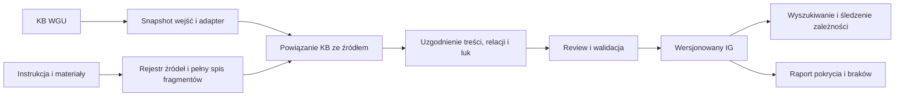

# Architektura WGC: KB z WGU i instrukcja jako wejście do IG

- **Data:** 2026-10-11.
- **Status:** propozycja architektury na zlecenie właściciela; nie zaimplementowany kontrakt.
- **Cel pierwszego wydania:** IG całej instrukcji SPQR 5E, z wykorzystaniem istniejącej KB.
- **Podstawa:** rzeczywisty schemat i kod WGU oraz lokalna KB SPQR;
  [recenzja IG-0](reviews/IG-0-critical-review.md), [model](IG-DATA-MODEL.md).
- **Plan realizacji:** [IG-PLAN](IG-PLAN.md). Dane i przykłady wejściowe wyłącznie
  w `private/ig/planning/wgu-spqr-2026-10-11/`.

**Doprecyzowany cel właściciela:** IG ma zasilać deterministyczny i szybki
mechanizm legalnych akcji przyszłego przeciwnika AI. Wymagania wykonawcze
opisuje [kontrakt legalnych akcji](IG-LEGAL-ACTIONS.md). Digitalizacja
i wyszukiwanie są podstawą tego celu, nie końcowym kryterium sukcesu.

## 1. Podział odpowiedzialności

WGU tworzy i utrzymuje KB: reguły, terminy, tabele, procedury, relacje,
niejasności i pytania kontrolne. WGC bierze zamrożoną KB oraz dokumenty
źródłowe, ustala ich powiązania, uzupełnia braki i buduje wersjonowany IG.
Rezultat pozwala odnaleźć regułę, zobaczyć dowód, przejść do zależności
i sprawdzić zakres jej weryfikacji. Warstwa semantyczna ma ponadto pozwalać
skompilować reguły do mechanizmu legalności i zmian stanu. AI wybiera
strategię, a ten mechanizm oblicza dopuszczalne decyzje bez użycia LLM.

KB jest źródłem istniejących opracowań, a oryginalne materiały są podstawą
sprawdzania ich znaczenia. WGC przechowuje obie warstwy. Nie nadpisuje WGU
i nie przepisuje automatycznie całej KB od nowa. Poprawka powstała w WGC
jest oddzielną propozycją z pochodzeniem; ewentualny eksport poprawek do
WGU będzie osobnym, późniejszym zadaniem.

Pierwszy rezultat obejmuje całą instrukcję. Rozdziały są jednostkami pracy
i checkpointami jednego przebiegu, nie osobnymi pilotami. OSG i GCACW
pozostają profilami docelowymi, bez obowiązku digitalizowania ich przed SPQR.

## 2. Co wynika z istniejącego wejścia

Odczytano cały schemat `wgu/kb@1` oraz `store.py`, `export.py` i `lint.py`.
Zinwentaryzowano bajty wszystkich plików KB; treść sprawdzono fragmentarycznie.
Liczniki ustalono według rzeczywistego układu tekstu YAML, bez pełnej walidacji
parserem. Nie przeprowadzono ponownej semantycznej oceny całej KB ani instrukcji.

| Wejście SPQR | Obserwacja | Skutek dla projektu |
|---|---|---|
| Reguły | 523: 438 w części podstawowej i 85 w księdze scenariuszy | Import całości; odrębna selekcja źródeł i profili |
| Relacje | 233, w tym 226 oznaczonych `verified` | Zachować status WGU, niezależnie od review IG |
| Procedury | 11 głównych, 4 podprocedury, 80 kroków | Zachować hierarchię, kolejność i tekst; nie zakładać kompletnej semantyki wykonania |
| Tabele | 48 z `complete: true` | Oddzielić kompletność opracowania od zgodności i odczytu źródła |
| Pozostałe kolekcje | 134 terminy, 79 niejasności, 3 zmiany, 59 pytań kontrolnych | Reużycie z jawnym rodzajem i pochodzeniem |
| Reguły i źródła | Każda ma `source`, żadna pola `digital` | Lokalizatory wymagają uzgodnienia; formalizacja nie jest gotowym wejściem |
| Pliki źródłowe | 36 wskazanych materiałów nieobecnych pod ścieżkami konfiguracji | Rejestr braków i jawne przypięcie dostępnych kopii |

W archiwum WGC jest pełny 44-stronicowy PDF SPQR 5E; ścieżkę rozwiązano
przez manifest, hash jest zgodny. KB nie przypina hasha swojego oryginału,
więc zgodność bajtów obu wejść pozostaje nieznana. Można zbudować nowy IG
względem jawnie wybranego PDF, sprawdzając importowane opracowanie z jego
treścią. Nie wolno deklarować, że odzyskano dokładnie oryginał użyty przez WGU.

## 3. Wybór architektury i prostsza alternatywa

| Wariant | Koszt i ograniczenie | Ocena |
|---|---|---|
| Dodać tylko wyszukiwanie nad KB | Najmniej pracy; przydatne dla pytań i nawigacji, lecz nie rozlicza niezależnie pominięć źródła ani aktualności akceptacji | Wystarcza dla przeglądarki KB; nie spełnia celu IG z dowodami |
| Rozszerzyć schemat WGU o cały IG | Jeden format, ale miesza utrzymanie KB, transkrypcję, review i profile oraz wymaga zmian w innym repo | Niepotrzebne sprzężenie pierwszego wydania |
| Adapter WGU i warstwa IG w WGC | Reużywa KB, dodaje źródła, mapowanie, rewizje, luki, pokrycie i review | **Rekomendowany wariant** |
| Atomizacja instrukcji od początku | Powtarza istniejącą pracę i utrudnia ustalenie, skąd pochodzą rozbieżności | Stosować lokalnie do luk, nie jako domyślny przebieg |

Na start: pliki JSON/JSONL z walidatorem i indeksami pochodnymi.
Graf jest logicznym modelem relacji; nie potrzebuje serwera bazy grafowej.
Jeden importer, jeden model pośredni i jeden eksport wystarczą do pierwszego
pełnego wydania. Wybór magazynu można zmienić bez zmiany znaczenia danych.

## 4. Kontrakt wejścia

Podstawowy adapter czyta katalog gry: `wgu.yaml`, pełne `kb/` i jawnie
wskazane materiały pomocnicze. Adapter `wgu/kb-bundle@1` jest dodatkową
drogą importu, a nie warunkiem pracy z obecną KB.

Eksporter WGU usuwa część informacji o plikach, zapisuje krótki `source_rev`
i czas generacji. Nie eksportuje wszystkich plików pomocniczych KB ani
pełnej konfiguracji źródeł. Dlatego sam bundle nie dowodzi pełności wejścia:
WGC wymaga do niego manifestu źródeł, hasha bundle i rejestru dostępności
sidecarów. Brakująca konfiguracja lub lokalizacja pozostaje jawna.

Każdy import zapisuje:

- surowe bajty wejść, względną ścieżkę, SHA-256, rozmiar i typ;
- wersję schematu WGU i adaptera, konfigurację importu oraz dostępny commit;
- stan pozyskania i dostępności każdego źródła, wydanie, język i rolę;
- mapę plików i rekordów, również plików nieznanych adapterowi;
- diagnostykę parsowania, nieznanych pól, duplikatów i nierozwiązanych odwołań.

Hash plików identyfikuje faktyczne wejście także przy niezacommitowanych
zmianach. Niedostępny commit ma `unknown`, nie pustą wartość oznaczającą
czysty stan. Zmiana pliku podczas zamrażania przerywa snapshot i wymaga
powtórzenia. Parser nie wykonuje tagów YAML; odrzuca powtórzone klucze.
Ścieżki z KB nie mogą samoczynnie rozszerzać zakresu odczytu poza manifest.

Brak źródła blokuje potwierdzenie jego treści, nie import pozostałej KB.
Przeniesiony plik można powiązać po hashu. Podobny tytuł lub zgodne wydanie
tworzą kandydata do przypięcia, nigdy dowód identycznych bajtów.

## 5. Mapowanie WGU na IG

Mapowanie jest wiele-do-wielu: reguła WGU może łączyć kilka klauzul,
a jedna klauzula źródła może być opracowana w kilku rekordach WGU.
Nie narzucamy równania „jedno zdanie = jeden rekord = jedna decyzja review”.

| WGU | Minimum IG | Czego import nie przesądza |
|---|---|---|
| `manifest`, konfiguracja | snapshot importu, źródła, kandydaci profili | Zgodności wszystkich materiałów |
| `chapter`, `section` | hierarchia obiektów i lokalizatory kandydackie | Kompletności źródła |
| `rule` | klauzula lub kontener klauzul; oryginalne pola jako aspekty | Poprawności streszczenia i atomowości |
| `when/effect/exceptions` | tekstowe aspekty, następnie jawne grupy warunek–skutek–wyjątek | Automatycznej logiki wykonywalnej |
| `source` | roszczenie o pochodzeniu, następnie powiązanie z regionem dowodowym | Że numer strony jest numerem strony PDF lub cytat jest wierny |
| `refs`, `see` | odwołania nawigacyjne | Relacji `requires` ani kompletnego łańcucha zależności |
| `relations` | kandydaci relacji typowanych wraz z warunkiem i statusem WGU | Akceptacji IG, kierunku i zakresu semantycznego |
| `procedures` | procedura, kroki, podprocedury, kolejność deklarowana przez KB | Wyzwalaczy, kontynuacji, przyczyn zdarzeń i trwałości wyborów |
| `terms`, terminologia | pojęcia, aliasy, definicje i roszczenia o zatwierdzeniu terminów | Tożsamości pojęć między wydaniami |
| `tables` | kontener tabeli, stabilne wiersze/kolumny, komórki i legenda | Że opracowanie tabelaryczne jest tabelą wydawcy |
| `ambiguities` | luki, konkurencyjne interpretacje, ewentualna decyzja źródłowa | Że `resolved` oznacza akceptację człowieka w IG |
| `changes` | deklaracje zmian wydania z dowodami i niepewnością | Kompletnej historii zmian |
| `scenarios` | przypadki kontrolne z odpowiedzią pochodzącą z KB | Scenariuszy gry ani niezależnego gold |
| `aids`, `digital`, nieznane pola | zachowany payload i odpowiednia projekcja lub luka mapowania | Wykonywalności i kompletności obsługi |

ID WGU zachowujemy jako klucz zewnętrzny w przestrzeni danej KB.
Stabilne ID IG są niezależne od treści i nazwy pliku. `origin_bindings`
łączy ID IG z ID WGU, snapshotem, plikiem i wskaźnikiem do pola.
Rewizję identyfikuje hash kanonicznego rekordu; zmiana treści nie tworzy
automatycznie nowej tożsamości.

Terminy i relacje bez ID dostają ID WGC zapisane w rejestrze mapowania.
Pozycja tablicy i hash treści lokalizują wejście, lecz nie są trwałym ID.
Po zmianie kolejności dopasowanie musi korzystać ze starego mapowania;
niejednoznaczne dopasowanie trafia do review. Podział/scalenie klauzul
ma jawne poprzedniki i nie przenosi automatycznie akceptacji.

## 6. Uzgodnienie z pełną instrukcją

1. Zamrozić pełny PDF i ustalić mapę stron PDF do numeracji drukowanej.
   Zachować tekst pomocniczy, render, kolejność odczytu i ich pochodzenie.
2. Niezależnie od KB sporządzić inwentarz wszystkich stron i ich regionów:
   nagłówków, klauzul, not, przykładów, tabel, legend i diagramów.
   Elementy redakcyjne także rozliczyć jako wyłączone z uzasadnieniem.
3. Dopasować rekordy KB po źródle, numeracji, stronie i treści. Identyfikatory
   oraz wyszukiwanie tekstowe dają kandydatów; dopasowanie wymaga dowodu.
4. Oznaczyć wynik: zgodność w zbadanym zakresie, częściowe odwzorowanie,
   sprzeczność, brak w KB, brak źródła albo możliwy duplikat.
5. Zachować zgodne opracowania; dopełnić pominięcia, rozdzielić nadmiernie
   zbiorcze klauzule, połączyć warunki ze skutkami. Propozycje semantyczne
   zapisywać obok niezmienionego importu wraz z metodą ich uzyskania.
6. Uzgodnić odwołania między rozdziałami i zakresy wyjątków; oznaczyć brakujące
   cele oraz zależności do materiałów spoza instrukcji.
7. Przeprowadzić review z widocznym źródłem, różnicą względem KB i wpływem
   na zależności. Wydać snapshot oraz raport pokrycia i otwartych kwestii.

Prace interpretacyjne można wykonywać w lokalnej sesji z zapisem propozycji.
Rdzeń WGC nie wymaga dostawcy inferencji ani API. Narzędzie ma przygotować
pakiet pracy i bezpiecznie przyjąć wynik, nie udawać, że parser YAML rozumie
reguły. Surowa odpowiedź, użyty kontekst i faktycznie znana konfiguracja
wykonawcy są artefaktami przebiegu. Nieznana konfiguracja pozostaje nieznana.

## 7. Profile i materiały mieszanych wydań

Pierwszy profil obejmuje całą instrukcję podstawową SPQR 5E, również opcje
opisane w niej, z warunkami stosowania. Materiały tabelaryczne i scenariuszowe
z KB importujemy w całości, ale ich status zgodności jest osobny.
Księga scenariuszy innego wydania nie staje się częścią profilu podstawowego
przez samą obecność w tym samym katalogu.

Profil przypina konkretne źródła i decyzje o ich współstosowaniu.
Ogólne pierwszeństwo „nowsze wygrywa” lub „scenariusz wygrywa” z KB pozostaje
deklaracją interpretacyjną, dopóki nie ma odpowiedniego uzasadnienia.
Pomoce nieoficjalne zachowujemy jako opracowania; nie dostają autorytetu
wydawcy. Pusta lista errat oznacza brak zarejestrowanych errat, nie dowód
ich nieistnienia.

Pełna reprezentacja instrukcji może zawierać jawne zależności do brakujących
kart. To nadal pełne rozliczenie dokumentu, lecz nie pełna wiedza potrzebna
do rozstrzygnięcia wszystkich sytuacji gry. Raport musi odróżniać te stany.

## 8. Semantyka do digitalizacji i legalnych akcji

W pierwszym etapie zapisu obowiązkowe są klauzule i adresowalne aspekty, grupy
warunków/skutków, typowane relacje z uzasadnieniem, zakresy, dowody i luki.
Tekst może przejściowo pozostać `opaque`, lecz z oznaczeniem ograniczenia użycia.
Należy zachować rozróżnienia obecne w źródle: procedura i reakcja, zdarzenie
i jego przyczyna, wybór i jego dalsze wykorzystanie, wynik naturalny
i zmodyfikowany, kolejność modyfikatorów i zaokrągleń.

Geometria wieloheksowa, ZOC, LOS, ścieżki, losowania z puli, dowodzenie,
zwycięstwo, stan i historia otrzymują opis i powiązania. Zakres potrzebny
legalnym akcjom i ich skutkom wymaga formalizacji przed wydaniem pakietu
gotowego dla AI. Tabele zachowują osie, jednostki, symbole i legendy;
nie sprowadzamy ich do niepowiązanych liczb. Informacja ukryta w instrukcji
jest regułą widoczności; nie wprowadzamy jeszcze tajnego stanu partii.

Elementy wykonawcze z [profilów mechanik](IG-MECHANICS-PROFILES.md)
dobieramy do wymagań [legalnych akcji](IG-LEGAL-ACTIONS.md). Złożone wyjątki,
powroty i zachowane wybory muszą mieć jednoznaczną semantykę w zakresie
używanym przez mechanizm. Opaque wpływające na legalność jest blokadą,
nie zadaniem delegowanym LLM podczas każdej decyzji.

## 9. Review, aktualizacje i kompletność

Review może obejmować całą klauzulę z aspektami lub wybrane pola, zawsze
z dokładnymi rewizjami celu, źródła, profilu i istotnych zależności.
Oddzielamy kontrolę techniczną, zgodność ze źródłem oraz interpretację.
Statusy WGU zapisujemy jako obserwacje importowane, nie decyzje IG.

Przy aktualizacji WGU porównujemy trzy stany: poprzednie wejście WGU,
nowe wejście WGU i aktualne opracowanie WGC. Niezmienione rekordy zachowują
ID; kolizje ze zmianami WGC wymagają rozstrzygnięcia. Usunięcie w WGU
tworzy informację o wycofaniu pochodzenia, nie usuwa historii IG.
Zmiana podstawy review unieważnia jego aktualność tylko w zależnym zakresie;
nieznana kompletność podstawy daje `unknown`, a nie automatycznie `current`.

Raport pokazuje osobno:

- import: liczba wejściowych rekordów obsłużonych, zachowanych surowo i błędnych;
- rozliczenie źródła: każdy zinwentaryzowany region odwzorowany, wyłączony
  z powodem albo wskazany jako luka; pełny wykaz stron i części dokumentu;
- odwzorowanie treści: regiony faktycznie reprezentowane, bez doliczania luk;
- review: zakres i liczba aktualnych akceptacji, odrzuceń i pozycji oczekujących;
- relacje: rozstrzygnięte cele, nieznane cele i blokady zależności;
- zgodność materiałów i zakresy, dla których odpowiedź pozostaje nieustalona.

Mianownik pochodzi z niezależnego spisu źródła. Sama obecność reguły pod
każdym nagłówkiem ani 100% zaimportowanej KB nie dowodzą pełnego IG.
Snapshot roboczy może rozliczać całą instrukcję z lukami. Wydanie oznaczone
jako zweryfikowane wymaga aktualnego review całego deklarowanego zakresu
i braku nierozstrzygniętych blokad w tym zakresie; nie opiera się na próbie.

## 10. Proponowane moduły i artefakty

To granice odpowiedzialności przyszłego kodu, nie istniejące polecenia.

| Moduł | Odpowiedzialność | Wynik |
|---|---|---|
| `inputs` | snapshot, hashe, schema WGU, błędy i dostępność | manifest i niezmienne wejścia |
| `wgu_adapter` | import, mapowanie tożsamości, zachowanie nieznanych pól | obiekty importu i `origin_bindings` |
| `sources` | strony, regiony, dowody, inwentarz niezależny od KB | źródła, regiony, coverage inventory |
| `reconcile` | kandydaci dopasowań, propozycje, różnice i konflikty | klauzule, aspekty, relacje, luki |
| `review` | pakiety przeglądu, decyzje, aktualność i wpływ zmian | rejestr review i raport zmian |
| `validate_export` | integralność, selekcja profilu, pokrycie, eksport | snapshot IG, diagnostyka i indeks |
| `semantics_compile` | typowany stan, akcje, procedury, skutki i kompilacja | pakiet reguł z mapą do IG |
| `legal_runtime` | domeny decyzji, walidacja i deterministyczne zmiany stanu | legalne wybory dla AI i ślad wykonania |

Publiczne: kod, schematy, syntetyczne fixture i dokumentacja.
Prywatne: `private/ig/projects/spqr/inputs/`, `sources/`, `runs/`, `reviews/`
i `releases/`. Snapshot wydania zawiera manifest, wybrane rewizje rekordów,
mapę pochodzenia, profile, raport luk i pokrycia oraz wynik walidacji.
Indeksy wyszukiwania dają się odtworzyć z eksportu.

Powtórzenie deterministycznego importu tych samych bajtów daje te same
rekordy i hash treści; czas przebiegu jest metadanymi poza tym hashem.
Wyniki interpretacji nie są z założenia deterministyczne: odtwarzalność
oznacza zachowanie konkretnej propozycji i podstawy jej przyjęcia.

## 11. Koszt i regresje

Obecna KB ma 1090 pozycji najwyższego poziomu w wyliczonych kolekcjach,
łącznie z relacjami. To liczba wejścia, nie liczba przyszłych klauzul ani
zleceń review. Dochodzą kroki, regiony, dowody i rewizje. Aspekty i komórki
powinny być adresowalne wewnątrz kontenerów, bez osobnej decyzji dla każdej.

Koszt mierzymy podczas pracy nad pełną instrukcją: minuty rozpoznania źródeł,
dopasowania, review i korekt, osobno według typu obiektu. Robocza prognoza
to suma `liczba pakietów danego typu × zmierzona mediana czasu` plus
rozstrzyganie konfliktów i poprawki. Bez pomiaru nie deklarujemy godzin
ani mnożnika rekordów. Budżet określa tempo, nie zgodę na ukryte pominięcia.

Testy techniczne muszą wykrywać: utratę pól importu, duplikaty ID, zmianę
kolejności elementów bez ID, brak źródła, błędne strony, zmianę wersji,
nierozwiązane odwołania, mylenie `refs` z zależnością, przeniesienie statusu
WGU na akceptację, nieaktualny review, konflikt aktualizacji i utratę pokrycia.
Przypadki semantyczne obejmują grupowanie warunków, wyjątki, tabele i procedury;
ich expected wymagają niezależnego uzasadnienia źródłowego.

Pytania kontrolne KB służą regresji i wykrywaniu rozbieżności. Odpowiedzi KB
nie są niezależną oceną poprawności tego samego importu. Istniejące przypadki
badawcze pozostają niezaliczone do czasu wykonania i review. Archiwalny gold
i oryginalne odpowiedzi pozostają niezmienne.

## 12. Ustalony cel i pozostałe ustalenia wejściowe

Zlecone: plan narzędzia w WGC, wykorzystanie KB WGU i pełnej instrukcji SPQR,
a docelowo szybkie, deterministyczne legalne akcje dla przeciwnika AI.
Obecna sesja wyłącznie planuje. Nie ma bramki pilota 20 klauzul.

Przy realizacji trzeba dopiąć trzy ustalenia wejściowe:

1. **Konkretny profil gry:** pełny dokument podstawowy 5E jest zakresem
   digitalizacji. Wybrać scenariusz i opcje pierwszej integracji z mechanizmem
   oraz pozyskać wszystkie potrzebne karty i dane komponentów. Braki nie
   blokują importu, ale blokują gotowość legalnych akcji w zależnym zakresie.
2. **Źródło podstawowe:** rekomendacja — przypiąć dostępny PDF 5E jako źródło
   nowego IG i uzgodnić z nim KB, bez deklaracji zgodności bajtów z dawnym
   wejściem WGU. Alternatywa — dostarczyć pierwotny zestaw WGU.
3. **Organizacja review i odbioru:** wskazać recenzenta i dostępny czas oraz
   sprzęt docelowy do pomiarów szybkości. Pełny snapshot roboczy jest etapem
   pośrednim; gotowość dla AI wymaga domkniętej semantyki i kontroli legalności.

Adapter, pliki jako magazyn, grupowanie klauzul i import jednokierunkowy
są rekomendacjami technicznymi tego planu. Właściciel nie musi osobno wybierać
każdego pola schematu. Zlecenie planu nie jest zaliczeniem IG ani uruchomieniem
implementacji. Mechanizm legalności i skutków jest częścią planowanej budowy;
w tej sesji nie powstają silnik, UI ani API inferencji.
