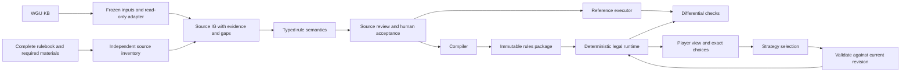

# WGC architecture

This is the active architectural proposal; machine contracts are established task by
task. [Queue](work/queue.json) defines execution order, [data model](IG-DATA-MODEL.md)
defines record invariants, and [runtime contract](IG-LEGAL-ACTIONS.md) defines gameplay.

## Ownership and boundaries

WGU maintains its KB. WGC reads a frozen directory snapshot and original documents,
preserves both, records discrepancies, and builds versioned interpretations.
It never edits WGU as an import side effect. Corrections are separate WGC proposals.
The runtime owns authoritative game state and history; an LLM description is not state.
AI owns strategy only. UI, online services, providers, and a graph database are not
prerequisites. Start with local JSON/JSONL, deterministic exports and derived indexes.

| Module / future path | Responsibility | Output |
|---|---|---|
| `src/wgc/inputs/` | Snapshot, safe paths, hashes, availability | Immutable input manifest |
| `src/wgc/wgu_adapter/` | Safe parsing, unknown fields, identities | Import records and origin bindings |
| `src/wgc/sources/` | Pages, regions, evidence, independent inventory | Coverage denominator |
| `src/wgc/reconcile/` | Matches, disagreements, omissions, editions | Source IG and explicit gaps |
| `src/wgc/review/` | Review packets, decisions, freshness | Revision-scoped decision ledger |
| `src/wgc/semantics/` | Types, expressions, actions, procedure IR | Formal IG linked to source clauses |
| `src/wgc/reference/` | Simple deterministic execution | Independent comparison baseline |
| `src/wgc/compiler/` | Type/closure checks and lowering | Reproducible executable package |
| `src/wgc/runtime/` | Actions, validation, events, replay | State transitions and legal choices |
| `src/wgc/player/` | Visibility, compact views and deltas | Player-safe decision interface |

These are planned boundaries, not existing implementations. Tests live in corresponding
`tests/<module>/` directories; public fixtures are synthetic. Source-derived data lives
in `private/ig/projects/spqr/`. Planning tools in `scripts/` do not implement these modules.

## Existing input evidence

The 2026-10-11 textual inspection recorded 523 rules (438 core, 85 scenario-book),
233 relations, 48 tables, 134 terms, 79 ambiguities, 3 changes, 59 control questions,
11 main procedures, 4 subprocedures and 80 steps. These are inventory observations,
not successful YAML/schema validation or source review. The 27 inspected files were
hashed. All 36 configured source paths were unavailable at that inspection.
The private inventory is preserved under `private/ig/planning/wgu-spqr-2026-10-11/`.
Recheck bytes when implementing; do not turn these counts into hard-coded gold.

An archived 44-page SPQR 5E PDF has been copied, hash-verified, into the active source
registry `private/ig/sources/spqr-5e/`. Its provenance records the old path and hash.
Identity with WGU's unavailable original is **unknown**. Explicitly pin it as the source
of a new IG; reconcile WGU content against it rather than claiming to recover WGU's original.

## Import contract

Primary input: game `wgu.yaml`, complete `kb/`, and explicitly enumerated auxiliary
files. The optional `wgu/kb-bundle@1` route is later work: the current exporter omits
some auxiliary files and full source configuration, abbreviates revision information,
and adds a generation time. A bundle alone cannot establish complete input accounting.

Freeze raw bytes, relative paths, sizes, SHA-256, schema/adapter versions and import
configuration. Git commit and dirty state are supporting metadata; record unknown
when inaccessible. Detect source changes during snapshotting. Reject unsafe YAML tags,
duplicate keys, traversal, and paths escaping the allowlist; preserve unknown fields.
Unavailable PDFs block source verification, not import of available KB records.

| WGU entity | Source IG mapping | Never infer |
|---|---|---|
| Rule, when/effect/exceptions | Clause container, addressable aspects and groups | Executable logic or correct atomization |
| Source locator | Provenance claim, then evidenced region binding | PDF page identity or exact quotation |
| refs / see | Navigational references | Required semantic dependencies |
| Relations | Typed candidates, original status retained | IG acceptance from `verified` |
| Procedures | Nested steps, local identities and declared order | Binding lifetime, triggers or continuation semantics |
| Tables | Axes/cells/notes; distinguish editorial summaries | Literal publisher table from `complete: true` |
| Terms without IDs | Persistent mapping registry | Identity from list position or content hash |
| Ambiguities / changes | Claims, gaps and evidence | Human resolution or complete edition history |
| scenarios / questions | Imported evaluation candidates | Battle scenarios or independent expected answers |
| Unknown fields and files | Lossless payload plus mapping status | Silent exclusion |

One KB rule may map to several clauses and vice versa. IDs are stable and separate
from content revisions. Reordering, splits, merges and ambiguous matches preserve
lineage and require explicit resolution. Wildcards and subpoint references retain
their raw form until an exact target set is justified.

## Complete sources and reconciliation

Inventory all 44 PDF pages independently of the KB: headings, clauses, notes, examples,
tables, legends, diagrams, and editorial regions. Keep PDF page number separate from
printed labels. Text extraction is a helper; diagrams and meaningful decorations need
image evidence. Every region is represented, partially represented, a gap, or excluded
with a reason. Gaps never count as represented content.

Reconcile all imported records: exact/partial match, contradiction, missing KB content,
missing source, or possible duplicate. Preserve KB bytes, candidate interpretations,
evidence, and corrections separately. Cross-chapter exceptions and external tables
remain explicit dependencies. A table assembled by KB authors can cite multiple clauses;
do not invent a single publisher region for it.

Each profile pins edition, mode, options, scenario, source revisions and compatibility
decisions. A 2018 4E scenario book does not inherit 5E authority from the KB manifest.
Do not invent universal 'newer wins' or 'more specific wins' precedence. Unofficial
aids remain secondary material. An empty errata list is not proof that no errata exist.

## Revision, review and updates

One logical source IG links to one formal semantic representation; the executable
package is derived and immutable. All operations map back to exact clause/evidence
revisions. Do not maintain three independent hand-edited descriptions of a rule.

Review records pin target revision/aspect, evidence, profile and dependencies.
Technical checks, source/meaning review, and human acceptance are separate. Model
observations cannot grant semantic acceptance. Incomplete review bases imply unknown
freshness; changed bases imply stale. Acceptance is never inherited by a changed aspect.

Updates compare old WGU, new WGU and current WGC. Deletion in WGU retires provenance,
not IG history. Recompute impact through reads/writes, triggers, bindings, table/profile
dependencies and unresolved references. Preserve decisions; request new ones for affected
meaning. Rebuild packages and replay regressions before promoting an updated profile.

## Product readiness

Report input accounting, source coverage at each representation level, current human
acceptance, resolved dependencies, compiled scope, and gameplay readiness separately.
Opaque text is valid in a working source IG. If it affects legal choices, timing,
visibility, costs or effects, it blocks executable readiness of the dependent scope.
Unknown conditions cannot be assumed inactive to bypass a dependency.

## Provenance of this consolidation

Preserves the active IG design and 2026-10-11 WGU inspection, including IG-0 findings on
semantic groups, review bases, causal history, continuation instances, stable bindings,
random-pool multiplicities and visibility of diagnostics. Supersedes the earlier pilot
recommendation and broad IG-1 task. Pre-edit documents are byte-preserved in the
planning snapshot listed by [the archive register](ARCHIVES.md); they are not bootstrap context.
