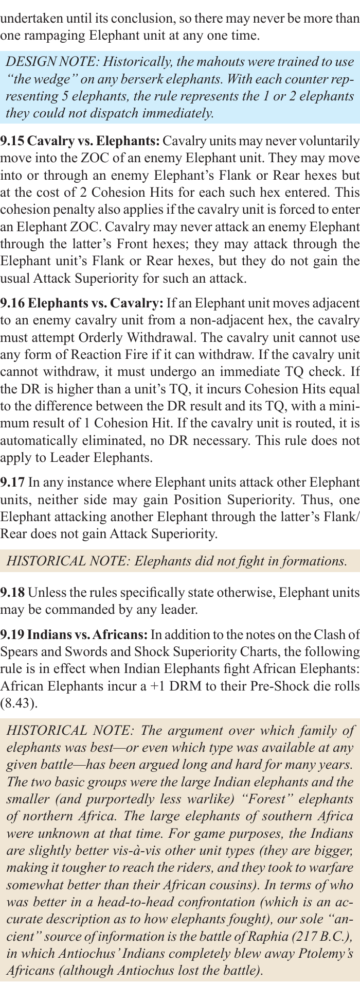
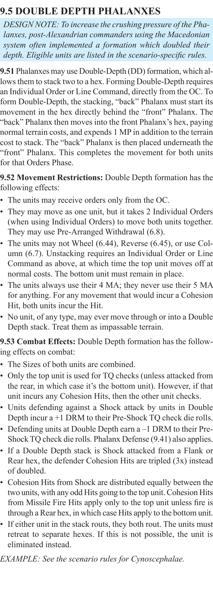
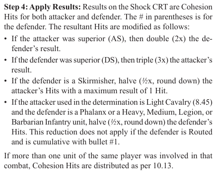

# Pierwszy przegląd M-POC5A — SEM-001/002/003

Propozycje oceniającego Codex, decyzje właściciela pending. Zakres to wskazane
gałęzie i operatory; nie akceptacja całych EXP-ID, obu odpowiedzi ani wszystkich
pozostałych pól. Pełne źródła, JSON pointers, bajty i hashe zakresów są w
[checklist.json](checklist.json), propozycje i ograniczenia w [issues.json](issues.json).

- eval-v1: `7debb9edffd9e0256a0065be335a743ce796660c67d5c6cdcfdddf433d3e8dce`.
- first-001: `3a4f7d9a1d20373fe5c320850456b8cb1acce5db00b86b5ca98f410656c51307`.
- context-01: `95b2254026aef3ba7c22a69917f8758d9f1bafa777c4d906f820bfeaca263c9b`.
- PDF źródła: `e5b65958ca04261058147966b10e1ab2785061fc50060390f8a4ce0e34c6d69e`.

## SEM-001 — 9.16, minimum CH i DR≤TQ

Źródło PDF 33 lewa kolumna, bbox [45,253.147,297.021,371.147]:
„If the DR is higher than a unit’s TQ, it incurs Cohesion Hits equal to the
difference between the DR result and its TQ, with a minimum result of 1 Cohesion Hit.”

Zatwierdzony zakres EXP-017: DR≤TQ daje 0 CH; DR>TQ daje różnicę, minimum 1;
minimum nie uchyla warunku DR>TQ.

**first-001 i context-01:** R916.action_effect zachowuje warunek DR>TQ i minimum 1;
R916.interpretation ma unknown. G916 ma blocking=true i podaje, że wynik DR≤TQ
nie został ustalony. Te rekordy są treściowo identyczne w obu wynikach.

Propozycja: niepełna lokalna interpretacja i nieuzasadnione pozostawienie blokady
gałęzi DR≤TQ w obu wynikach. Nie stwierdzono twierdzenia „zawsze 1 CH”.
Transkrypcja/wyjątek Leader Elephant oceniane osobno; E916 urywa dolną linię
i pozostaje dawnym błędem lokatora, mimo czytelnego źródła pełnego regionu.
Nie oceniamy pełnego OW, realnego TQ ani całej EXP-016.

## SEM-002 — 9.53, Rout i eliminacja każdej PH

Źródło PDF 34 prawa kolumna, bbox [315,660.32,567.03,694.32]:
„If either unit in the stack routs, they both rout. The units must retreat
to separate hexes. If this is not possible, the unit is eliminated instead.”

Zatwierdzony lokalny zakres EXP-040: obie PH Rout; każda jest eliminowana osobno,
jeśli nie może wykonać legalnego Rout; druga może wykonać własny legalny Rout.
Rzeczywista geometria, kolejność, wspólny jedyny cel, 6.69/10.22 i późniejszy
wynik D1 pozostają nierozstrzygnięte. Wcześniejszy przegląd miał dodatkowe
podparcie 10.24/25/23 — jego dostępność ekstraktorowi wymaga osobnego rozliczenia.

**first-001 i context-01:** R953.action_effect zachowuje both rout i separate hexes,
ale powtarza „the unit is eliminated instead”. R953.interpretation=unknown;
G953.blocking=true pozostawia liczbę eliminowanych jednostek nierozstrzygniętą.
Rekordy są treściowo identyczne w obu wynikach.

Propozycja: niepełna reprezentacja potwierdzonego lokalnego zakresu eliminacji
per-unit w obu wynikach; brak dowodu błędnego odczytu. Sam tekst 9.53 i wcześniejsza
akceptacja w ocenie nie certyfikują dostępności dodatkowego źródła w wejściach.
Ocena tej różnicy oraz jej przyczyny pozostaje decyzją właściciela.

## SEM-003 — 9.32 i nowy fragment 8.46 Step 4

9.32, PDF 34 lewa kolumna: LC zadająca Hits PH/HI/MI/LG/BI ma pół, round down.
Literalny przykład z AS mówi o użyciu printed result on Shock CRT.

**first-001:** R932 podaje lokalne pół/floor. N932ex zachowuje przykład,
interpretation=unknown; G932 pozostaje blocking. Brak nowego wyjątku Routed
w lokalnym tekście, z zastrzeżeniem możliwych kwalifikacji zewnętrznych.

**context-01:** R932.interpretation dodaje 2× wyniku obrońcy przy AS, pół/floor
wyniku obrońcy przy LC użytym w determination (8.45) przeciw wymienionym klasom,
wyjątek Routed i kumulatywność z AS. R932.exceptions wprost dodaje wyjątek Routed
z nowego źródła. R932.action_effect nadal podaje lokalne pół/floor; kwalifikację
trzeba czytać wraz z interpretation/exceptions. N932ex nadal unknown;
G932/GCTX-order zachowują blokadę pełnej kolejności i wyniku.

Propozycja: zaakceptować wyłącznie źródłowe podparcie tych warunkowych operatorów
i wyjątku w context-01. Brak decyzji o zgodności całej R932 lub domknięciu EXP-031.
Nie uznawać 2× i pół za automatyczne znoszenie; kolejność/floor, applicability,
baza CRT i pełny wynik pozostają nierozstrzygnięte.

Nowa relacja DCTX932-S4 wymaga osobnego review źródła/celu/kierunku/rodzaju;
ta decyzja o operatorach nie nadaje jej TP. Nowa DCTX923-S4 jest osobną SEM-004.

## Pozostałe jawne pending

W obu wynikach nadal brakuje trzech krytycznych osobnych par niejawnych
DEP-NEW-001/002/003 i czterech wzmianek. Semantyczne FN nie nadane.
126/131 krawędzi pozostaje do review; nowe/pending nie są pewnymi TP ani FP.
58 dawnych i 6 nowych granic glifów oraz E916 mają osobny zakres przeglądu.
74 oczekiwania, 207 pozycji i 277 par rubryka/EXP-ID są rozliczone w rejestrze,
lecz bez decyzji człowieka pozostają pending. 20 sytuacji dotyczy osobnej M-POC5B.
